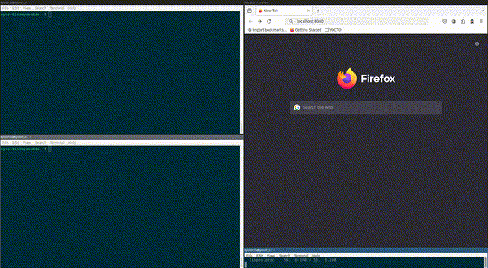

# Overview
`netbird_connection_watcher` is an application that monitors connection status of a NetBird client daemon service running on `mipsel`-based embedded Linux devices and sends it to a host PC so it can be observed in a browser on a local host:



## Prerequisites
- OpenWrt device with a network connection with the host machine and a running NetBird client
- `build-essential` - standard development tools (includes `make`)
- `mipsel-linux-musl-gcc` - cross-compiler toolchain
    - if not available from the package repository, obtain the source directly, build it locally and add it to PATH:
    ```
    cd
    wget https://musl.cc/mipsel-linux-musl-cross.tgz
    tar xf mipsel-linux-musl-cross.tgz
    export PATH=$PWD/mipsel-linux-musl-cross/bin:$PATH
    ```
- `ssh` installed both on host machine and target device

## Build and run
*For simplicity's sake, the binary you obtain from cross-compiling will be directly copied to the device in `tmp` folder instead of creating an .ipk package that would be integrated into the image.*

From the root of the project directory, simply run `make` which will create the binary inside the build directory. Now copy the binary to the device with:
```
scp -O build/netbird_connection_watcher  root@<target-device-ip>:/tmp/
``` 

Now, from the host PC, open an SSH session to the device with local port forwarding:
```
ssh -L 8080:127.0.0.1:8080 root@<target-device-ip>
```
to bridge the embedded Linux device and host PC by enabling local port forwarding. This way, the PC acts as some kind of a proxy to the router and visiting `http://localhost:8080` in the PC's browser will expose the output from the target device's app.

Now open another SSH session in a separate terminal and run:
```
cd /tmp/
./netbird_connection_watcher
```

Finally, on your host PC, open a new tab in the browser and type:
```
http://127.0.0.1:8080/
```
to observe the NetBird connection status of the target embedded Linux device.

# Creating an .ipk package (ADVANCED USAGE)
There are several ways of creating a package for OpenWrt-based devices. I have used a derivative of OpenWrt SDK which is why this guide will be a general description of how to cross compile and include `netbird-connection-watcher` package into the final image. To create such a package that fits nicely into the OpenWrt SDK, make sure your file structure looks like this:

```
.
├── files
│   └── netbird-connection-watcher.init
├── Makefile
└── src
    └── main.c
```

Keep the source code (`main.c`) same as it's laid out in this repository and copy the following files into your build toolchain:

`netbird-connection-watcher.init`:
```
#!/bin/sh /etc/rc.common

USE_PROCD=1

# Start value of netbird-connection-watcher should be greater than the start value of netbird by at least 1.
# Keep it two-digit: init scripts are started in alphabetical order, so S100 would run before S11.
START=99
STOP=10

NAME=netbird-connection-watcher

start_service() 
{
    	# wait until netbird is actually responding
    	while ! /usr/bin/netbird status >/dev/null 2>&1; do
        	sleep 2
    	done
	procd_open_instance
	procd_set_param command /usr/bin/netbird-connection-watcher
	procd_set_param respawn
	procd_close_instance
}
```

and
`Makefile`:
```
include $(TOPDIR)/rules.mk

PKG_NAME:=netbird-connection-watcher
PKG_VERSION:=1.0
PKG_RELEASE:=1

PKG_BUILD_DIR := $(BUILD_DIR)/$(PKG_NAME)

include $(INCLUDE_DIR)/package.mk

define Package/netbird-connection-watcher
  SECTION:=net
  CATEGORY:=Network
  SUBMENU:=VPN
  TITLE:=NetBird connection watcher
  DEPENDS:=+netbird
endef

define Build/Prepare
	mkdir -p $(PKG_BUILD_DIR)
	$(CP) ./src/* $(PKG_BUILD_DIR)/
endef

define Build/Compile
	$(TARGET_CC) $(TARGET_CFLAGS) \
		-o $(PKG_BUILD_DIR)/netbird-connection-watcher \
		$(PKG_BUILD_DIR)/main.c
endef

define Package/netbird-connection-watcher/install
	$(INSTALL_DIR) $(1)/usr/bin
	$(INSTALL_BIN) $(PKG_BUILD_DIR)/netbird-connection-watcher \
		$(1)/usr/bin/netbird-connection-watcher

	$(INSTALL_DIR) $(1)/etc/init.d
	$(INSTALL_BIN) ./files/netbird-connection-watcher.init \
		$(1)/etc/init.d/netbird-connection-watcher
endef

$(eval $(call BuildPackage,netbird-connection-watcher))
```
Once you have these files in your SDK as part of a feed (e.g. a local feed added to `feeds.conf` with `src-link custom /path/to/your/packages`), update the package feeds and install the `netbird-connection-watcher` package by running the following in your SDK directory:
```
./scripts/feeds update -a
./scripts/feeds install netbird-connection-watcher
```
which registers the `netbird-connection-watcher` package into the build system. Then, run:
```
make package/netbird-connection-watcher/compile V=s
```
to actually build the package called `netbird-connection-watcher_1.0-1_<target_architecture>.ipk`. The resulting package is now placed inside the SDK's build directory for the specific target architecture you have built the package for.

You can now add this package to your image build system and enable it in `make menuconfig` under `Network` -> `VPN` -> `netbird-connection-watcher` (this location is defined by `CATEGORY` and `SUBMENU` in the package's Makefile).

Finally, from the root directory of the build system run:
```
make
``` 
which will produce the final image with the `netbird-connection-watcher` package included into the build.

*NOTE: you might not see the `netbird-connection-watcher` process running when you check the running processes on your device, because the procd init system quietly gives up on bringing this process up if the app cannot execute `netbird status -d` or bind to port 8080. In this case, the latter is the reason for this behavior. The app doesn't have a bulletproof check of the NetBird client actually being up and running and connected to NetBird's central Management Server, since the idea of creating a package like this was to demonstrate how to create a custom package that you can include in the final image.*
